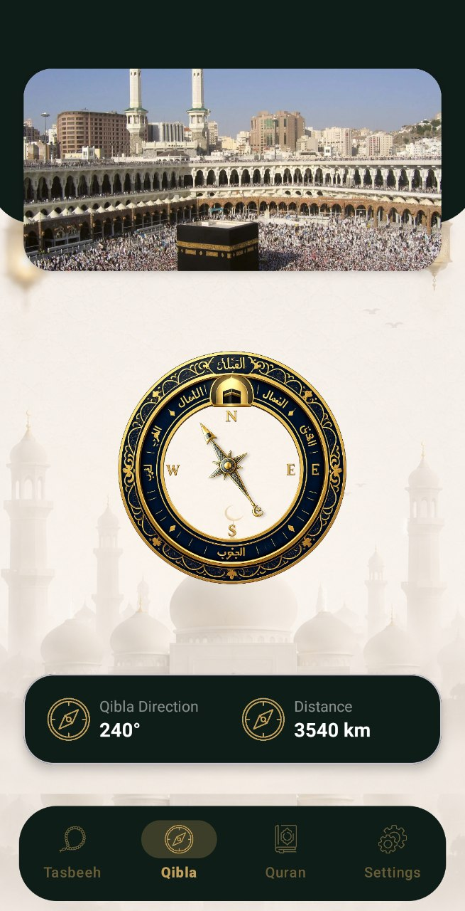
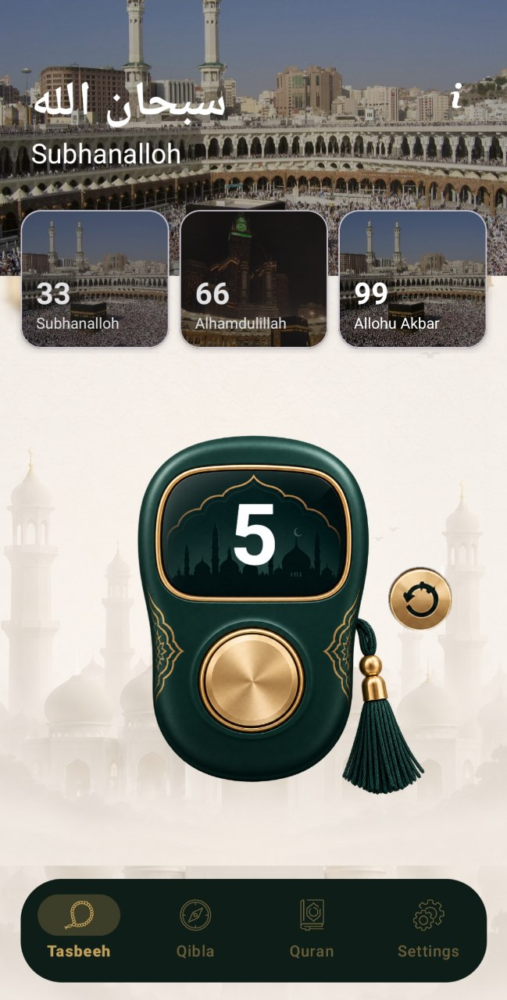
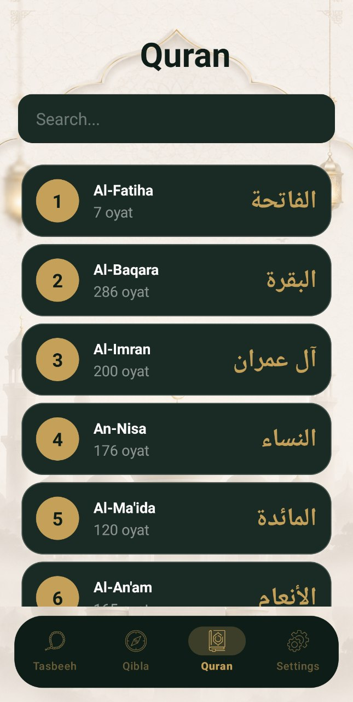
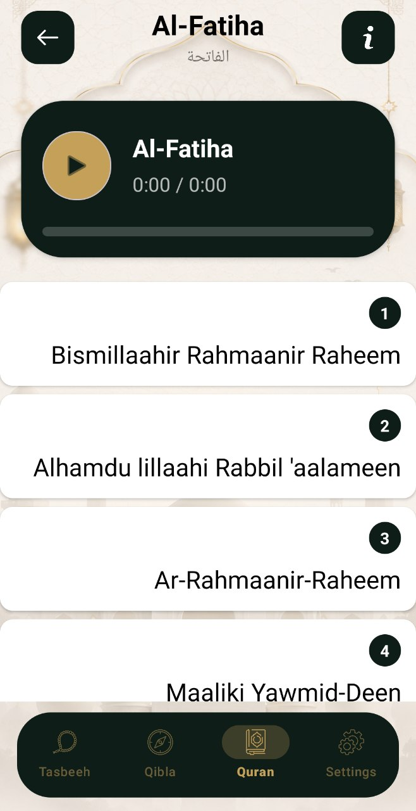
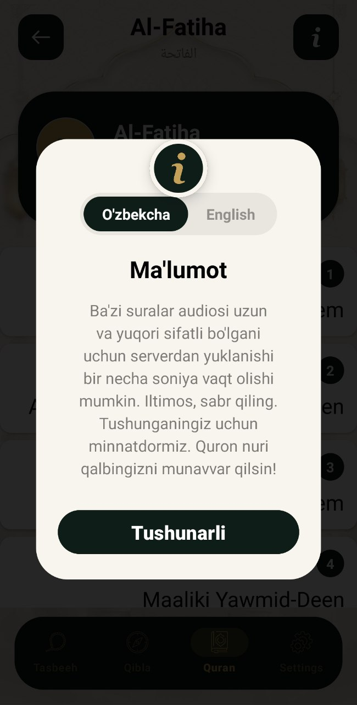
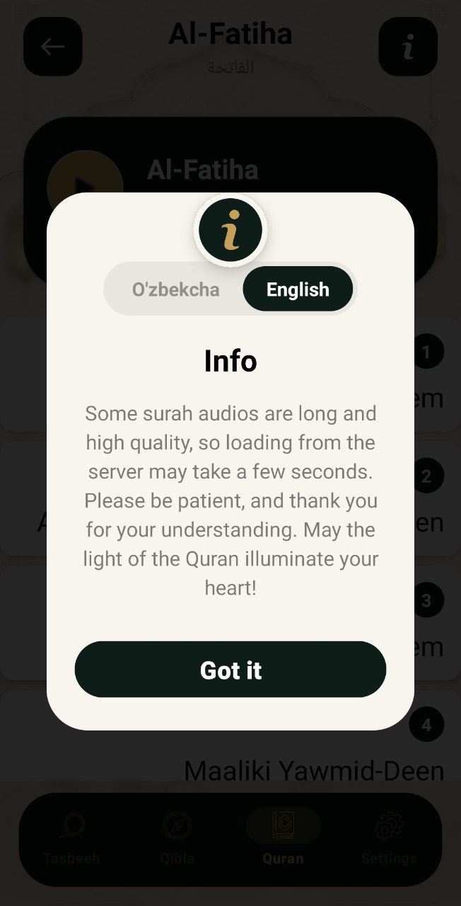
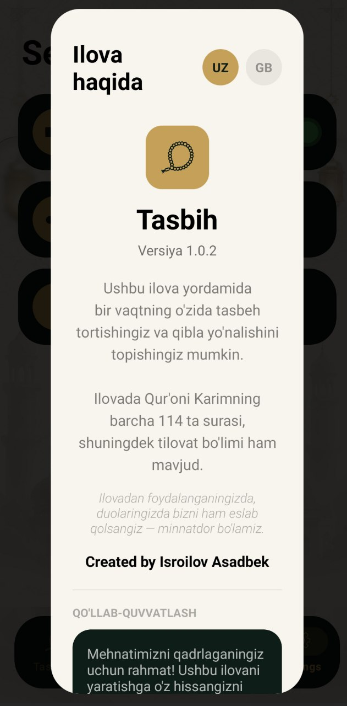
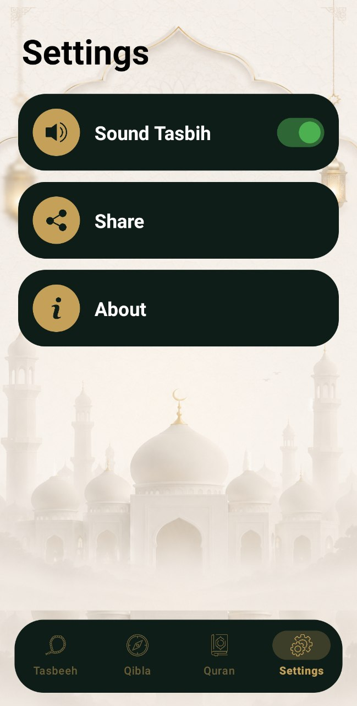

# 🕌 Tasbeeeh — Islamic Companion App

<p align="center">
  
  
  
  
</p>

<p align="center">
  <b>Your daily companion for Dhikr, Qibla direction, and Quran recitation.</b>
  <br/>
  A Kotlin-based Android application designed to make daily Islamic practices simple and convenient.
</p>

---

## 📱 Screenshots

<p align="center">
  
  
  
  
</p>

<p align="center">
  
  
  
  
</p>

---

## ✨ Features

### 📿 Tasbeeh Counter
- Count your daily dhikr with a simple counter.
- Choose between 33 and 99 repetitions.
- Get audio feedback with click sounds.
- Toggle sound effects in settings.

### 🧭 Qibla Compass
- Find the direction of the Qibla.
- Uses device location and sensors.
- Integrates GPS location services and Android sensor data.

### 📖 Quran Reader
- Browse all 114 surahs of the Holy Quran.
- Search for surahs easily.
- Read transliteration text.
- Listen to Quran recitations online.
- Retrieve Quran content through the Al Quran Cloud API.

### ⚙️ Settings
- Enable or disable sound effects.
- Share the application with others.
- Manage basic app preferences.

---

## 🛠️ Tech Stack

| Technology | Purpose |
| Kotlin | Main programming language |
| Android Views (XML) | User interface development |
| ViewBinding | Type-safe view access |
| Navigation Component | Screen navigation |
| Bottom Navigation | Main app navigation |
| RecyclerView | Displaying Quran surahs |
| Retrofit | API communication |
| Gson | JSON parsing |
| Al Quran Cloud API | Quran text and audio |
| Google Play Services Location | Device location |
| SensorManager | Compass functionality |
| MediaPlayer | Audio playback |
| SharedPreferences | Local settings storage |

---

## 🏗️ Architecture & Implementation

The application is built using native Android development technologies.

- **UI:** XML layouts with ViewBinding.
- **Networking:** Retrofit and Gson for API requests and JSON conversion.
- **Navigation:** Android Navigation Component and Bottom Navigation.
- **Location:** Google Play Services Location.
- **Sensors:** Android SensorManager for compass functionality.
- **Audio:** MediaPlayer for sound and recitation playback.
- **Persistence:** SharedPreferences for user preferences.

---

## 🚀 Getting Started

### Prerequisites

- Android Studio
- Android SDK
- A physical Android device or emulator
- Internet connection for online Quran content and audio

### Installation

**1. Clone the repository**

```bash
git clone https://github.com/acadlvv7-dev/Tasbeeeh.git
```

**2. Open the project**

Open the `Tasbeeeh` project in Android Studio.

**3. Sync Gradle**

Allow Android Studio to download the required dependencies and complete the Gradle sync.

**4. Run the application**

Connect an Android device or start an emulator, then click **Run ▶**.

### Permissions

Some features require device permissions or hardware support:

- **Location:** Used to obtain the user's location for Qibla functionality.
- **Sensors:** Used to determine compass direction.
- **Internet:** Required to retrieve Quran text and audio.

Actual Qibla accuracy depends on device sensors, location accuracy, and calibration.

---

## 🌐 API Integration

This application uses the **Al Quran Cloud API** to access Quran-related content.

🔗 **API website:** https://alquran.cloud/

Internet access is required for online Quran content and audio recitation.

---

## 🎯 Project Goals

Tasbeeeh was developed to explore and apply practical Android development concepts, including:

- Building native Android applications with Kotlin.
- Creating interfaces using XML and ViewBinding.
- Implementing navigation between screens.
- Integrating REST APIs.
- Working with location services and device sensors.
- Handling audio playback and local preferences.

---

## 👨‍💻 Author

**Asadbek Isroilov**

- GitHub: [@acadlvv7-dev](https://github.com/acadlvv7-dev)

---

## ⭐ Support

If you find this project useful, consider giving the repository a ⭐ on GitHub.

<p align="center">
  <b>Built with Kotlin and ❤️</b>
  <br/>
  <i>Making daily Islamic practices more convenient through technology.</i>
</p>
